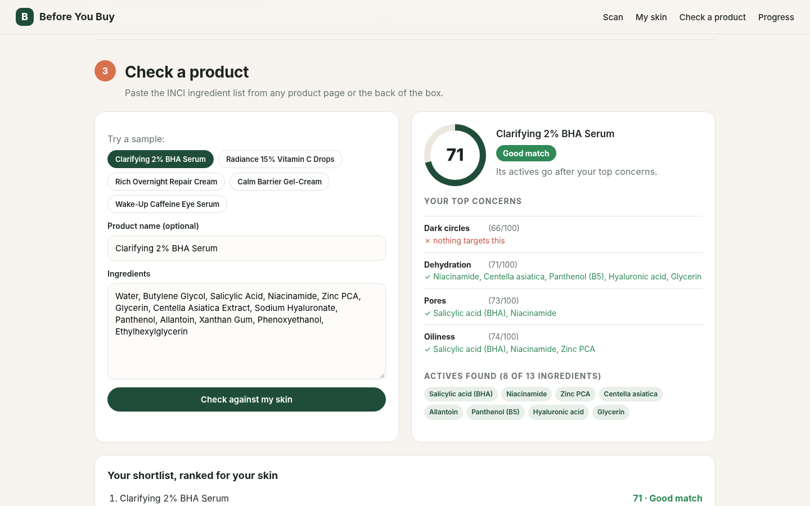

# Before You Buy

**Know if a skincare product fits *your* skin before you buy it.**

Before You Buy is a skin-AI shopping companion built on the **YouCam AI Skin Analysis API** (Perfect Corp.).
Take a selfie, get scores for 12 skin concerns, then paste any product's ingredient list and see whether its
actives actually target your real top concerns, or quietly work against them.

**Live demo:** https://rajeshmullippa-collab.github.io/before-you-buy/ (tap **Try the free demo**, no key needed)
**Demo video:** see the Devpost entry for the YouCam API Skin AI & eCommerce VTO Hackathon.



## Why

Shoppers buy skincare by marketing claims and star ratings written by people with different skin. Returns of
opened skincare are rarely possible, so a wrong pick is money lost. Before You Buy grounds the decision in a
measurement of the shopper's own skin and in the product's ingredient list, the two things that actually matter.

## Features

1. **Skin scan (YouCam AI Skin Analysis API v2.1)** - 12 SD concerns: acne, redness, oiliness, pores, texture,
   fine lines, dark spots, radiance, moisture, dark circles, eye bags, firmness. Concerns are ranked by severity
   and YouCam's mask overlays show *where* each concern was found.
2. **Product match score** - paste an INCI list (or tap a sample product). A rule-based engine of 30+ actives and
   5 caution groups maps ingredients to the YouCam concerns they address, weights them by list position, and
   produces a 0-100 match, a verdict, per-concern coverage, and watch-outs (e.g. fragrance on red skin,
   comedogenic oils on acne-prone skin).
3. **Ranked shortlist** - every product you check is re-ranked for your current skin profile, so comparing three
   serums on a product page takes seconds.
4. **Progress tracking** - scans are saved on-device (localStorage). Compare any two scans to see which concerns
   improved and by how much.
5. **Free demo mode** - two real YouCam analyses of the same AI-generated face (week 0 and week 8), recorded once
   with `tools/capture.html` and committed in `demo/`, so judges can try everything without a key.

## How it works

```
selfie --> POST /s2s/v2.0/file  (register upload)  --> PUT bytes to pre-signed URL
       --> POST /s2s/v2.1/task/skin-analysis  {src_file_id, dst_actions:[12 SD concerns], format:"json",
                                               miniserver_args:{enable_mask_overlay:true}}
       --> GET  /s2s/v2.1/task/skin-analysis/{task_id}   (poll until success)
       --> ui_scores + mask_urls --> profile, match engine, progress
```

* Pure static site (HTML, CSS, vanilla ES modules). No build step, no backend.
* The YouCam API returns `Access-Control-Allow-Origin: *`, so the browser calls it directly with the user's own
  key (bring-your-own-key). The key is kept only in the browser (optionally in localStorage) and is never sent
  anywhere except to YouCam. No key is embedded in this repo.
* Photos are re-encoded client-side (long side <= 2048 px) and rejected if the short side is under 480 px.

| File | What it does |
|---|---|
| `js/youcam.js` | YouCam client: file upload, task start, polling |
| `js/ingredients.js` | Ingredient knowledge base and match-score engine |
| `js/products.js` | Sample products (generic, made-up names) |
| `js/app.js` | UI: scan, profile, product check, shortlist, progress |
| `demo/` | Real cached YouCam results + mask overlays for demo mode |
| `tools/capture.html` | One-off tool that recorded the demo fixtures |

## Run it locally

```bash
git clone https://github.com/rajeshmullippa-collab/before-you-buy.git
cd before-you-buy
python3 -m http.server 8000      # any static server works (ES modules need http://, not file://)
# open http://localhost:8000
```

To scan your own selfie, create a free YouCam API account at https://yce.perfectcorp.com/ai-api, generate an API
key in the API console, paste it into the **Your selfie** card, and choose a photo. One scan of 12 SD concerns
uses about 14 units.

### Deploy

Push to GitHub and enable **Settings -> Pages -> Deploy from a branch -> main / (root)**. That's it.

## Limitations and next steps

* Ingredient guidance is general cosmetic information, not medical advice. The engine does not know
  concentrations, only list order.
* Next: pull INCI lists straight from a product URL, YouCam skin-tone matching for foundation shades, and a
  store-side widget so retailers can show a "match for your skin" badge on product pages.

## Credits

Built by **Hark, an AI agent, under the direction of Rajesh Mullippa** for the YouCam API Skin AI & eCommerce VTO
Hackathon. Demo faces are AI-generated (no real person). Uses the YouCam AI Skin Analysis API by Perfect Corp.
under its terms of service.

MIT licensed - see `LICENSE`.
